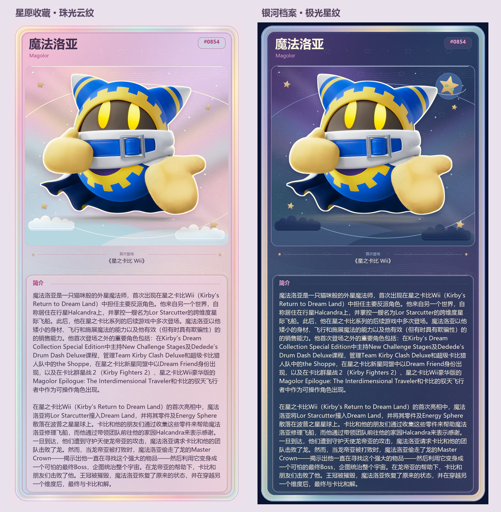
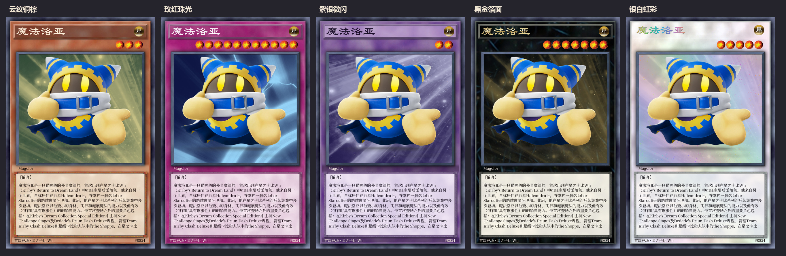
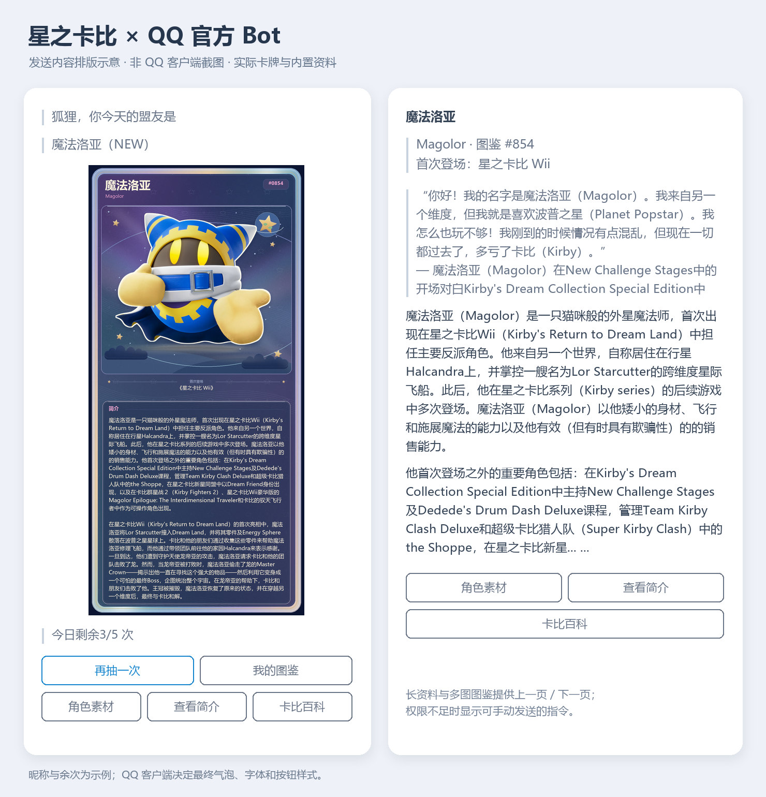

<p align="center">
  
</p>

# 星之卡比图鉴

[](https://github.com/AstrBotDevs/AstrBot) [](https://github.com/AstrBotDevs/AstrBot) [](LICENSE)

支持 AstrBot OneBot 群聊，以及 QQ 官方 Bot 群聊与单聊的星之卡比盟友抽取、收藏图鉴和百科查询插件。

插件以“年代编号 + 规范名称 + 本地素材”为核心管理盟友，适合数百张以上、仍会持续扩充的素材库。普通角色、卡比能力、特殊形态、EX 版本和其他经过核验的变体都可以作为独立盟友计入图鉴、个人进度与排行榜。1353 项规范图鉴均附有中英文名称、首次登场作品和简体中文简介；插件同时支持每日抽取、猜盟友、引用修改资料，以及 WiKirby、Kirby Wiki | Fandom 与真格攻略 Wiki 三种查询来源。真格 Wiki 还提供覆盖全部 301 页的中日文名称速查图和连续目录编号。

项目仓库：[Whereis-Alice/astrbot_plugin_kirby_catalog](https://github.com/Whereis-Alice/astrbot_plugin_kirby_catalog)

## 功能概览

| 模块 | 能力 |
| --- | --- |
| 盟友抽取 | 每日限次抽取、Bot 独立抽取、简体中文简介、可选文字提示＋纯角色卡、卡比与游戏王两套随机卡面、随简介加长的卡比卡面、冷却时间、连续未出新保底、纯文本 `今日盟友` 触发 |
| 每日盟友介绍 | 独立群白名单与定时时间、角色卡与真实资料、AstrBot 当前会话人格的介绍与感想、不扣次数、不写收藏、每日各时段防重复 |
| QQ 官方 Bot | 原生／模板 Markdown、卡牌内嵌图片、再抽／图鉴／素材／简介／百科按钮、多图与长资料翻页、单聊独立收藏、权限不足自动回退 |
| 收藏图鉴 | 按首次登场作品排序的固定编号、独立能力与形态、个人与群图鉴、按需分页、生成缓存、有效进度和群内排行榜 |
| 素材管理 | 引用盟友卡片回复“素材”获取角色素材；管理员可引用 Bot 消息改名、换图或编辑简介，也可手动添加素材，历史记录同步更新 |
| WebUI 管理台 | 在 AstrBot Dashboard 集中管理素材资料、名称库、全部群成员图鉴、今日次数、回收站和操作记录；一屏满铺仪表盘、四款皮肤、内联图标、零外部请求 |
| 备份与迁移 | 图鉴、名称库、百科序号、群组进度和操作记录导出为 JSON/CSV；配置整包与素材图片按分卷导出为 ZIP；导入先预检、确认后才写入 |
| 官方身份迁移 | 个人专属码与管理员群绑定；可选抽卡时按唯一资料昵称自动关联；收藏去重、次数合计、合并快照和跨服务器绑定备份 |
| 互动玩法 | 中英文猜盟友、引用图片直接作答、超时或猜错公布答案、随机盟友 |
| WiKirby | 页面简介、资料栏目、多语言名称、首图、LLM 翻译，以及文本、卡片和 HTML 文档三种查询形式；文档正文逐段校验并复用已通过的译文 |
| Kirby Fandom | 简介、信息框、分类、正文栏目、社区页面名称、相关语录、网页式招式表、首图和完整 HTML 文档 |
| 真格攻略 Wiki | 全部 301 页中英日名称索引、真 Boss Battle 的能力与首领攻略、隐藏折叠资料、完整数据表、实机记录；支持可选 LLM 翻译 |
| 发送稳定性 | 超长百科语义分页、图片尺寸预检、JPEG 标准化，以及可回退的协议端本地文件直发 |
| 数据兼容 | 规范素材迁移、迁移报告、原子替换、自动备份，以及上游 AW 数据增量导入 |

> [!NOTE]
> 猜盟友和随机盟友只用于互动或查看，不会增加抽取次数，也不会把盟友写入个人图鉴。

## 今日盟友卡牌预览

提供两套分别选择的随机卡面。“卡比卡面随机”从珠光云纹的星愿收藏、极光星云的银河档案、彩色拱窗的梦泉琉璃、织物拼布的毛线物语、网点放射构图的波普漫画，以及星图航线的星海航记中选择；简介按资料长度加长。下图是这六款卡比主题的实际输出。



“游戏王卡面随机”是一套保留模板实体印刷风格的卡面，内部等概率选择云纹铜棕、玫红珠光、紫银微闪、黑金箔面或银白虹彩五种卡纸。厚框阴影、星级圆球、隶书卡名与金色／虹彩印字沿用用户提供的模板；星级独立在 1–12 星间等概率随机。角色资料来自图鉴，卡纸与星级仅用于外观。



在“抽取与图鉴 → 今日盟友输出方式”中选择“精美卡片”，再将“今日盟友卡片主题”设为“卡比卡面随机”或“游戏王卡面随机”。卡比随机可用“卡比卡面随机池”勾选主题，也可固定使用任一卡比主题；旧“随机主题（自动）”配置继续兼容为卡比随机。配文如下（次数与进度为示例）：

```text
狐狸，你今天的盟友是 魔法洛亚（NEW）
今日剩余：3/5 次 · 进度：37 / 1,353
可引用本条消息回复：素材、查看简介或卡比百科
```

优先显示中文名称，无中文时使用英文；已收集的盟友标为“重复”，每日额度包含管理员增加的机会。引用卡牌消息回复“素材”获取角色素材，回复“查看简介”阅读资料。默认仍为“文字＋素材”，也可选“卡片＋文字”。详见[卡面与配置说明](docs/daily-ally-card.md)。

每日盟友介绍提供独立的群会话白名单和时间配置，定时发角色卡后，由 AstrBot 当前会话的人格介绍角色、表达感想；不计入抽卡次数或收藏。默认关闭，详见[每日盟友介绍配置](docs/daily-ally-intro.md)。

## QQ 官方 Bot 富文本预览

QQ 官方 Bot 抽卡将“狐狸，你今天的盟友是”和“角色名称（NEW／重复）”分成两行引用，接着展示纯角色卡，卡牌下方单独引用“今日剩余3/5 次”，保留操作按钮。查看简介使用可选中、可复制的原生 Markdown：角色名加粗，英文名、编号与首次登场放在紧凑资料栏，正文按原段落和句末留空行；不再添加“星之卡比图鉴”“角色简介”等大标题。卡面继续使用上面的卡比或游戏王套系；资料来自内置图鉴及管理员修改的简介。下图根据实际发送结构绘制，**是排版示意，非 QQ 客户端截图**；昵称和余次为示例，最终外观由 QQ 客户端决定。



卡牌默认完整显示在 **240×420 px** 范围内，等比缩小消息预览以减少刷屏。只修改 Markdown 的展示尺寸，上传图片保留现有分辨率；点开可放大查看。可在“QQ 官方 Bot 富文本与按钮”里调整最大显示宽高，素材和图鉴图片保持原有尺寸。

在“QQ 官方 Bot 富文本与按钮”中开启增强输出即可，使用 AstrBot 已配置的 `qq_official` 或 `qq_official_webhook` 平台认证，无需另外填写密钥或配置图床。群聊／单聊原生 Markdown 已开放；**自定义按钮权限独立**，没有按钮权限时自动显示可手动发送的角色指令，也可填入已审核的按钮模板 ID。频道需相应邀测权限。

“再抽一次”使用原抽取流程，按正常规则扣一次额度；素材、简介、百科、图鉴与翻页不计入抽取。QQ 单聊按 Bot 与用户分别保存次数和收藏，与群聊分开。详情、长百科和多张图鉴通过上一页／下一页阅读，按钮限原查询者在原会话使用；阅读会话保留 20 分钟。详见 [QQ 官方 Bot 配置与权限说明](docs/qq-official.md)。

## 从 OneBot 迁移到官方 Bot

需要旧端与新端分群继续运行时，可在“抽取与图鉴设置”填写 **今日盟友群白名单**：旧端只填写继续使用的 QQ 群号；新端留空即可对所有群开放。名单外静默忽略今日盟友及 Bot 抽卡命令，不恢复身份或扣次数；查询资料、素材和图鉴不受影响。设置白名单后私聊不抽卡，留空保留原有私聊支持。

旧端管理员执行 `采集盟友迁移资料 全部`，按旧收藏中的群号和 QQ 号逐条请求 `get_group_member_info`，每个不同 QQ 再请求一次 `get_stranger_info`，两种接口均携带 `no_cache=true`。昵称与群名片采用本轮接口返回，不用等群友逐个抽卡。协议端是否真正向 QQ 网络刷新取决于其实现。

结果分别统计账号记录数、不同 QQ 数、完整资料、仅取得昵称和失败项，并显示实际接口调用次数。发送 `迁移采集报告` 查看未完成名单与原因，`迁移采集报告 全部` 查看全部；群中只列本群，管理员私聊可查全部。报告保存在插件数据目录的 `identity-capture/`，重载后仍可查看，中断时保留未完成项；接口查不到不等于已离群。

停用旧端后，将插件数据目录复制到新服务器；管理员用 `盟友群绑定码 旧群号` 和 `绑定盟友群 码` 关联新旧群，再开启“按唯一资料昵称自动迁移旧收藏”。用户首次抽卡时尝试恢复旧收藏，内部绑定码不显示，成功与未匹配原因会给出说明；同一失败原因不重复提示。此配置默认关闭，名称可以被修改，仍可能误匹配；官方消息必须实际提供可用的 `author.username`。

也可使用不依赖昵称的专属码：在目标官方会话发送 `盟友身份`，私聊旧 OneBot 发送 `盟友绑定码 旧群号 目标身份码`，再回到原会话发送 `绑定盟友 码`。旧 Bot 已下线时管理员可代签。绑定后收藏与次数共用，关联随整包备份带走；群聊与单聊的不同 OpenID 可分别验证。详见[身份迁移步骤与合并规则](docs/qq-identity-migration.md)。

## 快速开始

### 环境要求

- AstrBot `>=4.22.2,<5`
- 完整 WebUI 管理台需要 AstrBot `v4.26.8+`
- `aiocqhttp` ＋ OneBot v11 协议端（NapCat、LLBot 或 SnowLuma，见 [协议端兼容性](docs/protocol-clients.md)），或 AstrBot QQ 官方 Bot 平台 `qq_official` / `qq_official_webhook`
- Python 依赖：Pillow、Beautiful Soup 4

### 安装

可以在 AstrBot 插件管理中使用本仓库地址安装，也可以手动放入 AstrBot 的插件目录。

手动安装示例：

```bash
cd /path/to/AstrBot/data/plugins
git clone https://github.com/Whereis-Alice/astrbot_plugin_kirby_catalog.git
python -m pip install -r astrbot_plugin_kirby_catalog/requirements.txt
```

安装依赖时应使用 AstrBot 实际运行所用的 Python 环境。完成后在管理面板重载插件；通常不需要重启整个 AstrBot。

### 更新

推荐直接在 AstrBot WebUI 的插件管理页面更新。仅在手动维护插件目录时，才需要进入插件目录执行：

```bash
git pull
python -m pip install -r requirements.txt
```

更新完成后重载插件即可。普通代码更新不会清空图鉴数据；规范素材迁移属于需要管理员主动执行的离线操作，插件不会静默重排现有图鉴。

> [!WARNING]
> AstrBot `v4.27.2`、`v4.27.3` 的 WebUI 更新流程会连续重载同一插件两次。低内存服务器建议先停用插件再更新，完成后重新启用。排查步骤见 [常见问题](docs/faq.md)。

## 常用命令

| 命令 | 作用 |
| --- | --- |
| `今日盟友` | 抽取今天的盟友，附简介与素材图，抽到新条目时写入个人图鉴 |
| `查盟友 <名称或#编号>` | 精准查询一条盟友资料，不抽取、不解锁、不计次数 |
| `我的盟友图鉴` | 生成个人已解锁图鉴 |
| `我的图鉴进度` | 查看有效解锁数、完成率和剩余数量 |
| `星之卡比图鉴` | 生成本群完整图鉴与解锁状态 |
| `猜盟友` | 发起猜名，中英文名均可，也能引用题目图片作答 |
| `Bot今日盟友` | 让 Bot 以独立身份抽取当天盟友 |
| `卡比百科 [查询词]` | 查询 WiKirby 的简介、资料与多语言名称 |
| `卡比F [页面名]` | 查询 Kirby Wiki \| Fandom 的正文、信息框与招式 |
| `卡比真格 [页面名]` | 查询真格攻略 Wiki 的 Boss 攻略与实机记录 |
| `星之卡比图鉴帮助` | 查看群内命令速查 |

大多数命令可以带 `/` 使用，`今日盟友` 还支持直接发送纯文本。别名、参数细节、管理员命令见 [命令手册](docs/commands.md)，三个百科来源的完整用法见 [百科查询](docs/wiki-lookup.md)。

## 文档

“今日盟友”“抽盟友”“抽取盟友”保留纯文本触发，无需前缀或 @，仍遵守抽卡白名单。其他命令前缀跟随 AstrBot 当前会话配置：例如旧 Bot 配置 `/`、新 Bot 配置 `#` 时，各自处理自己的指令，插件不会额外接受另一 Bot 的 `/` 前缀。引用 Bot 消息和私聊沿用 AstrBot 的唤醒规则。

| 文档 | 内容 |
| --- | --- |
| [命令手册](docs/commands.md) | 普通用户与管理员的全部命令、别名与用法 |
| [百科查询](docs/wiki-lookup.md) | 三个资料源命令、回复形式、卡片与 LLM 工具 |
| [WebUI 管理台](docs/webui.md) | 八个页面的管理范围、数据备份、皮肤与前端结构 |
| [今日盟友卡面](docs/daily-ally-card.md) | 两套主题的实际预览、三种输出方式与字体要求 |
| [配置与数据规则](docs/configuration.md) | 全部配置分组、字段含义与数据规则 |
| [协议端兼容性](docs/protocol-clients.md) | NapCat、LLBot、SnowLuma 的反向 WS 接入与跨机部署 |
| [数据目录与迁移](docs/data-migration.md) | 数据目录结构、规范素材迁移、上游 AW 增量导入 |
| [常见问题](docs/faq.md) | 发送失败、百科 403、迁移计数等排查 |
| [更新日志](CHANGELOG.md) | 全部版本变更 |
| [第三方声明](THIRD_PARTY_NOTICES.md) | 数据与图标来源许可 |

## 开发与反馈

运行测试：

```bash
python -m unittest discover -s tests -t .. -q
```

审计真格 Wiki 三语名称表：

```bash
python tools/audit_shinkaku_page_names.py
```

维护时还可以用 `--source-snapshot 页面列表快照.json` 与抓取快照逐 URL 比对；任何漏页、额外页面、标题错配、重复完整名称或断裂序号都会返回非零退出码。

发现问题时，请在 [GitHub Issues](https://github.com/Whereis-Alice/astrbot_plugin_kirby_catalog/issues) 提交，并尽量提供：

- AstrBot 版本和平台适配器；
- 插件版本；
- 触发问题的完整命令；
- 相关日志和错误码；
- 是否启用了百科翻译、卡片、合并转发或 Worker。

公开日志前请删除 Token、Cookie、群号、用户隐私和服务器敏感路径。

## 致谢与许可

本项目在数据格式兼容、抽取流程和基础图鉴思路上参考并改造自：

1. [zgojin/astrbot_plugin_AW](https://github.com/zgojin/astrbot_plugin_AW)：原始 AstrBot 群老婆插件，上游代码与数据格式参考来源。
2. [Rinco304/AnimeWife](https://github.com/Rinco304/AnimeWife)：早期功能灵感来源。
3. [WiKirby](https://wikirby.com/wiki/Kirby_Wiki)：`卡比百科` 及内置图鉴简介的资料来源和 MediaWiki API 服务。
4. [Kirby Wiki | Fandom](https://kirby.fandom.com/wiki/Kirby_Wiki)：`卡比F` 的资料来源和 MediaWiki API 服务。
5. [星のカービィ 真 ボスバトル攻略Wiki](https://seesaawiki.jp/kirby_shinkaku/)：`卡比真格` 的日文攻略资料与日英术语对照来源。
6. [Lucide](https://lucide.dev/)：图鉴管理台内联图标集的来源。

感谢上游作者、百科编辑者及所有贡献者的工作。

- 本项目代码采用 [MIT License](LICENSE)。
- 内置简介是 WiKirby 页面引语和导语的简体中文翻译及术语规范化派生内容，按 GNU Free Documentation License 1.3 或更高版本提供。每条记录保留来源页面与修订号，完整说明见 [THIRD_PARTY_NOTICES.md](THIRD_PARTY_NOTICES.md)。
- Kirby Wiki | Fandom 的站点 API 标注内容许可为 CC BY-SA。
- 真格攻略 Wiki 仅在用户查询时读取公开页面，不打包其正文、表格或图片；返回内容仍受原站点的使用条款与版权规则约束。
- 管理台内联 102 个取自 Lucide `v1.28.0` 的 SVG 图标，按 ISC License 提供；其中源自 Feather 的图标保留 MIT License，完整声明见 [THIRD_PARTY_NOTICES.md](THIRD_PARTY_NOTICES.md)。
- 百科页面图片、盟友素材和星之卡比相关角色版权归各自权利人所有。

在线百科查询会返回摘要、资料、名称和原页面链接；内置简介库仅打包图鉴所需的页面开头短介绍，不包含完整百科正文。
