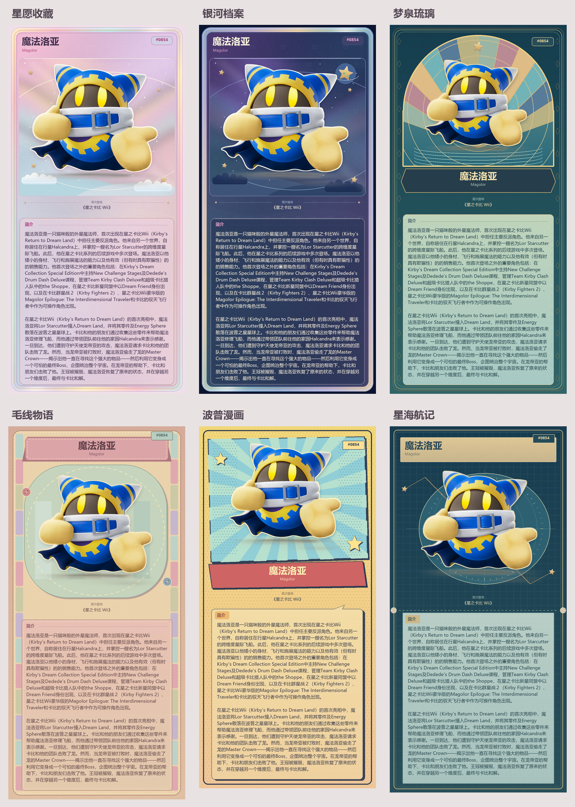

# 今日盟友纯角色卡

[← 返回 README](../README.md)

在插件配置的“抽取与图鉴”中，将“今日盟友输出方式”设为“精美卡片”或“卡片＋文字”，然后选择卡片主题。默认保留“文字＋素材”。



| 输出方式 | 效果 |
| --- | --- |
| 文字＋素材 | 原来的自定义文案、简介与素材图 |
| 精美卡片 | 带昵称的文字提示、抽取信息与引用说明，随后发送纯角色卡 |
| 卡片＋文字 | 保留完整自定义文案，补充抽取信息与引用说明，随后发送纯角色卡 |

同一设置作用于 `今日盟友`、`Bot今日盟友` 和 Bot 抽取工具。普通用户配文以“狐狸，你今天的盟友是 魔法洛亚（NEW）”开头，Bot 使用“爱丽丝：我今天的盟友是 魔法洛亚（NEW）”等提示，便于群内区分抽取者。名称优先使用已有中文，没有中文时使用英文；保留管理员中文改名及 EX 等形态标识。

配文示例（次数和进度仅为演示，实际读取本次抽取结果）：

```text
狐狸，你今天的盟友是 魔法洛亚（NEW）
今日剩余：3/5 次 · 进度：37 / 1,353
可引用本条消息回复：素材、查看简介或卡比百科
```

首次获得标为“NEW”，再次抽到、展示当天已抽到的盟友或图鉴已集齐时标为“重复”。余次以“剩余／当日额度”显示，分母包含管理员增加的机会，并与抽取结果一起保存快照；普通群友与 Bot 分别读取各自的数据。两种卡牌模式只显示一行引用命令列表，不再额外追加自定义百科提示；关闭百科提示开关后，该行只列出“素材或查看简介”。“卡片＋文字”保留原有主体文案与余次格式，将自动附带的百科提示合并为同一行命令列表。

## 卡面内容与主题

图片只展示角色名称、英文名、图鉴编号、大幅立绘、首次登场与“简介”。名称相同的中英文不重复显示；缺少出处或简介时隐藏对应内容。今日盟友标题、日期、收藏者、品牌水印、抽取状态、余次、收藏进度与操作说明均不放入卡面。

| 卡面 | 构图与材质 |
| --- | --- |
| 星愿收藏 | 珠光包边、粉紫浅蓝纸面、压印星纹与层叠云朵，简介使用同色系柔和底纹 |
| 银河档案 | 极光包边、深蓝星云、弧形细纹与星形波普之星，简介延续深蓝纹理 |
| 梦泉琉璃 | 金色拼接线和彩色琉璃拱窗，立绘下方放置角色铭牌，青绿磨砂底板承载简介 |
| 毛线物语 | 织纹、拼布边缘、缝线标题与纽扣，椭圆织物展示区和暖粉布袋式简介 |
| 波普漫画 | 网点、放射线、倾斜画框与红色标题带，暖色对话框承载简介 |
| 星海航记 | 星图网格、环形刻度与航线、黄铜标题铭牌，以票券虚线连接浅青航记区域 |

六套卡面在构图、装饰和阅读区上分别设计，纹理均由本地程序确定性绘制；简介底板降低纹样对比，保证文字清楚。没有额外图片服务依赖，角色素材沿用图鉴现有资料。

### 随机主题自动挡

1. 将“今日盟友卡片主题”（`ally_draw_card_theme`）设为“随机主题（自动）”。
2. 在“自动挡参与随机的卡面”（`ally_draw_card_random_themes`）中勾选想使用的主题，保存配置。

默认六套全部参与，每次卡片输出独立、等概率选择一套，可能连续出现同一卡面。只选一套时固定使用该套；留空或全部配置无效时使用全部六套，重复配置项不会增加权重。固定主题模式忽略随机列表。

自动挡同时用于普通用户、`Bot今日盟友` 和 Bot 抽取工具。它只决定已抽取角色的展示样式，不改变抽取概率、收藏、次数或引用查询；再次展示当天已抽到的角色时，也可能换用另一套卡面。

立绘先裁除透明或可识别的白色空边，再按比例填入更大的展示区，允许小素材放大，但不拉伸或裁切角色。小尺寸有限色像素图保留像素边缘，其他图片平滑缩放；低分辨率原图放大后仍受自身清晰度限制。此处理仅作用于卡面副本，不修改原素材。动态素材在卡面使用首帧，引用回复“素材”仍按原有发送设置提供该角色素材，保留支持的 GIF 动画。

## 简介与长度设置

“今日盟友卡片显示简介”默认开启，优先读取管理员人工简介，其次使用插件内置资料，不调用大模型编写角色介绍。它独立于消息文字的 `ally_description_enabled` 开关；关闭文字简介仍可显示卡面简介。关闭卡面开关或没有资料时，隐藏简介区域。

“今日盟友卡片简介最大字数”（`ally_draw_card_description_max_chars`）默认 1000 字，0 使用安全上限 2000 字。卡片宽 1024 像素，高度按实际内容在 1440–3000 像素间调整。保留段落，中英文名称、出处和简介均按实际字体宽度排版；简介最多显示 40 行，超出字数或阅读区的内容以省略号标明节选。原文有开篇引用时，优先展示可识别的角色介绍段落。

“卡片＋文字”和引用“查看简介”仍使用原有的 `ally_description_max_chars` 文字长度设置，需要完整资料时可将它设为 0。卡面简介使用自己的字数和行数上限。

## 引用查询与兼容性

引用卡片回复“素材”获取角色素材，回复“查看简介”读取资料，回复“卡比百科”继续查询百科；这些操作不重新抽取，不写入收藏，也不消耗次数。

卡片引用关系保存在插件数据目录的 `card_references.json`，重载后继续有效。消息编号按平台、Bot 和群隔离，图片指纹作为引用图片的补充识别方式；记录最多保留 90 天及 8192 张卡片，之前含编号的盟友消息仍可按文字识别。

图片在后台线程使用 Pillow 生成，不依赖网页截图服务或大模型。抽取结果先保存，再绘制卡片；生成失败会回退到文字与素材，不重新抽取，也不重复扣次数。卡片使用原有发送缓存的保留时间；素材损坏时仍可输出带星形占位图的卡面。

系统需有中文字体：Windows 使用微软雅黑，Linux 推荐 Noto Sans CJK 或文泉驿微米黑，macOS 使用苹方。Debian/Ubuntu 可安装 `fonts-noto-cjk`；缺少中文字体时会回退文字输出。

## 设计参考

- [星のカービィ クリアカードコレクション](https://www.kirby.jp/goods_item/21833/)：角色主视觉与收藏卡的清晰边界。
- [カービィカフェ WINTER 箔押しポストカードセット](https://www.kirby.jp/goods_item/22838/)：烫金、纸面与柔和配色的材质表现。
- [日本官方卡比角色页](https://www.kirby.jp/character/kirby/)：角色、跃星和波普之星的主题资料。
- [任天堂《毛糸のカービィ》](https://www.nintendo.co.jp/wii/rk5j/)：织物世界、拼布与缝线的主题表现。
- [任天堂《星のカービィ Wii デラックス》](https://www.nintendo.com/jp/switch/a2jya/index.html)：罗亚飞船、星形装饰与跨星球旅行的主题资料。
- [宝可梦伙伴插件](https://github.com/Whereis-Alice/astrbot_plugin_pokemon_partner)：参考本地 Pillow 渲染与可配置输出的组织方式。

卡面构图、背景、云朵、星轨和装饰由本插件原创绘图代码生成，不复制宝可梦卡面，也不打包上述网站的装饰图片。角色素材与简介沿用图鉴原有来源。
